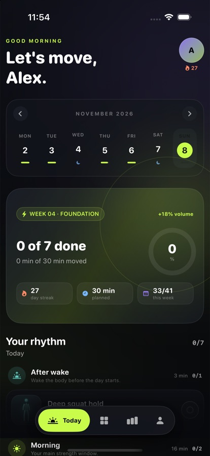
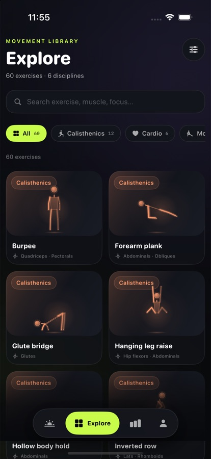
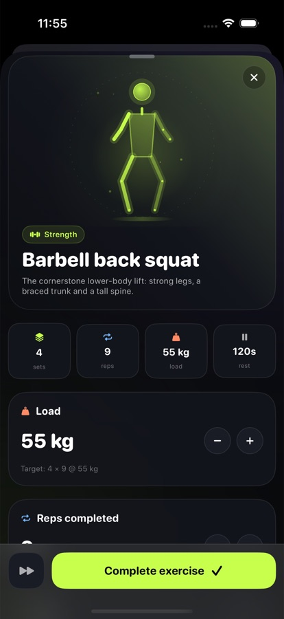
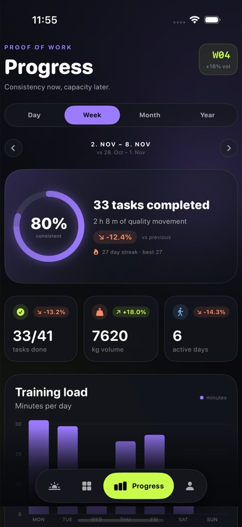

# Fitr

**Train on your rhythm.** A self-hosted fitness operating system: a catalogue of 60 exercises
with hand-authored vector animations, a daily plan across six time regions, and a progress
tracker that proves improvement week over week.

<p align="center">
  
  
  
  
</p>

```text
apps/
  ios/       SwiftUI app (iOS 18+), Canvas animation engine, unit tests
  server/    Bun + TypeScript API, SQLite schema, plan/progress domain, tests
  docs/      Docusaurus product, technology, roadmap and deployment documentation
  web/       Marketing site with real simulator screenshots
```

## Highlights

- **Catalogue** — 60 exercises across strength, calisthenics, yoga, mobility, cardio and
  recovery, classified by topic, type, 15 body regions, 29 muscles (primary and auxiliary),
  difficulty, equipment and coaching content. Filter by any dimension.
- **Today** — six time regions (after wake, morning, midday, afternoon, evening, before sleep),
  with rest days designed as recovery. The plan is generated from your goal, experience,
  equipment, training days and session length.
- **Progression** — volume rises 6% and intensity 4% per week, capped at +80% / +50%.
  Autoregulation adds 2.5 kg or 2 reps after a completed exercise at average effort ≤ 7.
- **Tracker** — day, week, month and year views; adherence, minutes, volume, sessions, streak,
  calendar heatmap, muscle balance, e1RM/rep/hold records and period-over-period improvement.
- **Health** — native HealthKit integration with Overview, Trends, Workouts and Sources views:
  steps, energy, exercise, sleep, heart rate, HRV, weight, workouts and contributing apps from
  Apple Health, filtered by range, metric, activity type and source. Optional write-back of
  completed Fitr sessions as workouts, with an explicit Fitr-authored audit. Health data stays
  on the device.
- **Motion** — 41 hand-keyframed skeleton sequences rendered live with SwiftUI Canvas. No video,
  GIF or sprite assets; crisp at any size and tinted by topic.
- **Self-hosted** — one Bun process, one SQLite file, no account or third-party analytics.
- **Offline catalogue** — the catalogue ships in the app; the last plan is cached on device.

## Quick start

```bash
# API + SQLite (seeds 60 exercises and demo history on first run)
bun install
bun run dev:server            # http://localhost:8787

# iOS app
cd apps/ios
xcodegen generate
open Fitr.xcodeproj           # run on any iPhone simulator

# Documentation
bun run dev:docs              # http://localhost:3000/fitr/docs/

# Marketing site (plain static files)
cd apps/web && python3 -m http.server 8080
```

The iOS app defaults to `http://localhost:8787`. Change it in **You → Connection** — on a
physical iPhone use your Mac's LAN IP (`ipconfig getifaddr en0`).

Open **Health** in the tab bar to connect Apple Health. The app reads activity, sleep, heart and
workout data on-device and can save completed Fitr sessions back as workouts. Add the HealthKit
capability to your signing profile when running on a physical iPhone; the simulator works with
the checked-in entitlement.

## Requirements

- macOS with Xcode 16+ (tested with Xcode 27.2 / iOS 18+ target)
- [XcodeGen](https://github.com/yonaskolb/XcodeGen) (`brew install xcodegen`)
- Bun 1.2+
- Node 20+ only for Docusaurus (Bun runs the build too)

## Commands

| Command | What it does |
| --- | --- |
| `bun run dev:server` | Start the API with file watching |
| `bun run test` | Server test suite (11 tests) |
| `bun run db:reset` | Delete the database; reseeds on next start |
| `bun run export:catalog` | Regenerate the iOS bundled catalogue |
| `bun run dev:docs` | Docusaurus dev server |
| `bun run --cwd apps/docs build` | Production docs build |
| `cd apps/ios && xcodegen generate` | Regenerate the Xcode project |

## Documentation

The documentation covers product, engineering and the decision log:

- **Product** — vision, features, progression model, design and motion.
- **Technology** — architecture, data model, API reference, iOS internals, animation engine,
  development and deployment.
- **Roadmap** — phased tasks with commit trail and upcoming work.
- **Decisions** — architecture decision records.
- **Changelog** — what shipped in each version.

When deployed via GitHub Pages:

- Marketing site: `https://<owner>.github.io/fitr/`
- Documentation: `https://<owner>.github.io/fitr/docs/`

Source: [`apps/docs`](apps/docs) and [`apps/web`](apps/web).

## Deployment

Both the marketing site and docs are built and published by
[`.github/workflows/deploy-pages.yml`](.github/workflows/deploy-pages.yml) as a single GitHub
Pages artifact:

- `apps/web` → `/`
- `apps/docs/build` → `/docs/`

The workflow is ready; nothing has been pushed to a remote yet. To publish:

```bash
git remote add origin git@github.com:<owner>/fitr.git
git push -u origin main
```

Then open **Settings → Pages → Build and deployment**, set **Source** to **GitHub Actions**,
and run (or re-run) the `Deploy site` workflow. Once it is green:

- Marketing site: `https://<owner>.github.io/fitr/`
- Documentation: `https://<owner>.github.io/fitr/docs/`

Finally, update `apps/ios/Fitr/App/AppConfig.swift` with your GitHub owner so the in-app
documentation and website links point at the live site.

No secrets are required. The workflow derives the owner and repository from
`GITHUB_REPOSITORY`, so Docusaurus uses the correct base URL automatically. See
[Deployment](apps/docs/docs/technology/deployment.md) for custom domains, server hosting, TLS
and the production checklist.

## Testing

```bash
# Server (in-memory SQLite per test)
cd apps/server && NODE_ENV=test bun test

# TypeScript
cd apps/server && bun run typecheck

# iOS unit tests
cd apps/ios
xcodegen generate
xcodebuild -project Fitr.xcodeproj -scheme Fitr -sdk iphonesimulator \
  -destination 'platform=iOS Simulator,name=iPhone 16 Pro,OS=18.5' \
  test CODE_SIGNING_ALLOWED=NO
```

CI runs all three on every push via [`.github/workflows/ci.yml`](.github/workflows/ci.yml).

## Demo data

The server seeds three completed weeks plus the current week up to yesterday, so charts,
streaks and records have a realistic baseline on first run. `bun run db:reset` starts from a
clean database.

## Production notes

The current API is single-user (`x-user-id`, default `me`) and intended for localhost or a
trusted LAN. Before exposing it to the internet, add authentication, TLS, restricted CORS,
rate limiting and database backups. The roadmap tracks this as the production-hardening phase.

## License

Private project. All rights reserved.
